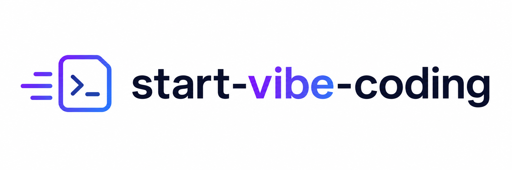

# start-vibe-coding

<p align="center">
  
</p>

Drop `INIT.md` into a fresh repo, tell your agent what you want to build, and let it start vibe coding with real project context from the first pass.

English | [简体中文](README.zh.md)

---

## What This Is

`start-vibe-coding` is a lightweight bootstrap protocol. It replaces the usual new-repo loop: a README, a project map, coding rules, and environment notes, restated every time a project starts.

An agent following `INIT.md` sets up human-facing docs, durable rules in `AGENTS.md`, a project map in `SPEC.md`, a shared log in `PROJECT_LOG.md`, a `presentation/` directory for reports, default repo files, and a root `.venv`.

---

## How To Use It

1. Copy `INIT.md` into the root of a new repository.
2. Describe what you want to build.
3. Ask the agent to initialize the project from the protocol.

```text
I want to build a personal expense tracker web app.
Initialize this project following INIT.md.
```

---

## What It Creates

- `README.md` — project overview and usage
- `PROJECT_LOG.md` — append-only history; also where agents branch tasks and aggregate results
- `SPEC.md` — project map, including how reports and the log are used
- `AGENTS.md` — durable coding and workflow rules
- `presentation/` — Jupyter notebooks or HTML files agents use to report results to humans
- `.gitignore`, `requirements.txt`, `LICENSE`, and a repository-root `.venv`

Translated READMEs such as `README.zh.md` are optional.

---

## License

[MIT License](LICENSE)
